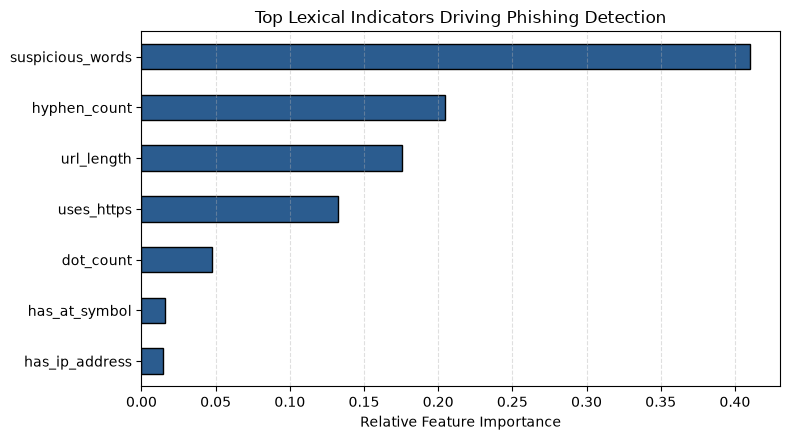
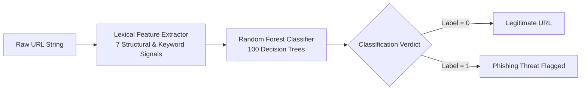

# Phishing URL Detection Using Lexical Feature Engineering


**A supervised machine learning pipeline built in JupyterLab that extracts lexical and structural signals from raw URLs to classify phishing links—without needing to visit or render potentially malicious web pages.**

Designed as a fast, explainable first-pass filter for SOC triage workflows and email security gateways.

---

## Visual Output



*Random Forest feature importance ranking showing which URL characteristics contribute most to distinguishing phishing links from legitimate domains.*

---

## System Architecture & Data Flow



---

## Extracted Lexical Features

| Feature | Type | Security Indicator & Attack Pattern |
| :--- | :---: | :--- |
| **`url_length`** | Integer | Phishing links are frequently padded with long query strings to obscure the true host. |
| **`hyphen_count`** | Integer | Spoofed domains heavily use hyphens to mimic brands (e.g., `secure-brand-login.xyz`). |
| **`dot_count`** | Integer | Excessive subdomains indicate domain spoofing (e.g., `brand.com.verify-user.info`). |
| **`uses_https`** | Binary (`0/1`) | Flags unencrypted `http://` login pages lacking TLS transport security. |
| **`has_ip_address`** | Binary (`0/1`) | Detects raw IPv4 hosts used to bypass domain registration checks. |
| **`has_at_symbol`** | Binary (`0/1`) | Identifies `@` URL redirect tricks where browsers ignore text before the `@` symbol. |
| **`suspicious_words`** | Integer | Counts high-urgency social engineering terms (`login`, `verify`, `update`, `secure`, `signin`). |

---

## Quick Start

### Prerequisites
* Python 3.11+
* JupyterLab

### Installation & Execution
1. Clone the repository and enter the project folder:
   `git clone https://github.com/yourusername/phishing-url-classifier.git && cd phishing-url-classifier`
2. Install the required data science and ML dependencies:
   `pip install jupyterlab pandas scikit-learn matplotlib`
3. Launch JupyterLab:
   `jupyter lab`
4. Open **`phishing_url_classifier.ipynb`** and click **Kernel -> Restart Kernel and Run All Cells** to generate the URL dataset, train the Random Forest classifier, test live predictions, and export the feature importance chart.

---

## Repository Structure

```text
phishing-url-classifier/
├── phishing_url_classifier.ipynb      # Main JupyterLab notebook with Markdown & ML pipeline
├── phishing_feature_importance.png    # Exported Matplotlib feature importance chart
├── requirements.txt                   # Pinned Python dependencies
├── LICENSE                            # MIT License
└── README.md                          # Project architecture and setup guide
```

---

## Security Takeaways & Future Roadmap

* **Explainable Threat Triage:** Using a Random Forest classifier provides transparent feature importance rankings, allowing security analysts to verify *why* a URL was blocked rather than relying on an opaque risk score.
* **Future Improvements:**
  * [ ] Benchmark model accuracy against a live threat-intelligence feed (such as OpenPhish or PhishTank CSV exports).
  * [ ] Enrich lexical features with WHOIS domain registration age and SSL certificate issuer checks.
